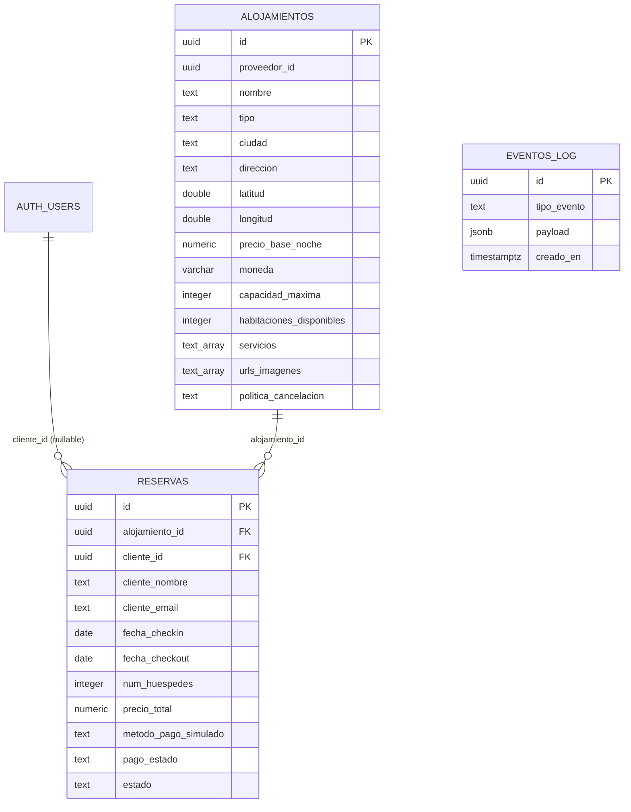

# Módulo de Alojamientos (Booking Prototipo)

Booking Prototipo es una aplicación de reservas de alojamientos desarrollada
como proyecto integrador. Su propósito es permitir explorar alojamientos,
gestionar cuentas y reservas, y administrar la operación desde una interfaz web.

La solución utiliza una arquitectura modular orientada a servicios: NestJS
separa autenticación, alojamientos, reservas y administración; Supabase aporta
PostgreSQL y Supabase Auth; y el Marketplace y el panel se sirven como recursos
web estáticos. El enfoque **API-First** se refleja en DTOs validados, contratos
OpenAPI y controladores REST. El log de eventos de la API anterior no publica a
un broker; el módulo Alojamientos v2 añade una Outbox transaccional y sincroniza
actualizaciones de stock con Booking por REST o, como alternativa, RabbitMQ.

> **Alcance:** Alojamientos v2 se implementa como módulo NestJS dentro de este
> repositorio; no es una aplicación independiente ni el servicio Booking de
> otros integrantes. La URL pública es un destino configurado, no una prueba
> de disponibilidad.

> **Estado del despliegue (4 de noviembre de 2026):** las solicitudes de
> verificación a Render agotaron el tiempo de espera. En una revisión anterior,
> el 7 de octubre de 2026, el Marketplace y Swagger respondieron
> **503 Service Unavailable**. Por lo tanto, el despliegue público y la
> conexión a Supabase de producción quedan **sin verificar**; revisa el estado
> en Render y vuelve a probar los endpoints antes de presentarlos como activos.

## 1. Resumen Ejecutivo y Estado del Despliegue

| Elemento | Implementación / estado |
| :--- | :--- |
| Backend | NestJS modular, API REST y validación de DTOs |
| Interfaz | Marketplace, login/registro y panel estáticos servidos por NestJS |
| Datos y autenticación | PostgreSQL en Supabase y Supabase Auth; operación en producción no verificada |
| Plataforma configurada | Render Web Service basado en Docker, descrito en [render.yaml](./render.yaml); despliegue Azure en preparación |
| Marketplace público | [booking-alojamiento.onrender.com/marketplace/](https://booking-alojamiento.onrender.com/marketplace/) — no verificado |
| Panel de administración | [booking-alojamiento.onrender.com/admin/](https://booking-alojamiento.onrender.com/admin/) — no verificado |
| Swagger integrado | [booking-alojamiento.onrender.com/api/docs](https://booking-alojamiento.onrender.com/api/docs) |
| Swagger de controladores NestJS | [booking-alojamiento.onrender.com/api/project-docs](https://booking-alojamiento.onrender.com/api/project-docs) |
| Verificación más reciente | Timeout HTTP al 2026-11-04; resultado anterior 503 al 2026-10-07 |


El repositorio contiene un [Dockerfile](./Dockerfile), un blueprint de Render
en [render.yaml](./render.yaml), configuración de variables de entorno y
scripts SQL para preparar Supabase. Esa configuración demuestra preparación
para despliegue, pero no prueba por sí sola que el servicio se encuentre
actualmente saludable, que esté conectado a una instancia de Supabase o que
los datos en producción estén disponibles.

**No declares cumplidos los criterios que requieren servicio operativo en nube**
hasta confirmar el estado `Live`, revisar los logs y probar HTTP, autenticación
y lectura de Supabase con respuestas exitosas.

### Arquitectura objetivo RDA2 (diseño, no despliegue actual)

La vertical puede separarse en `ms_catalog`, `ms_rooms`, `ms_inventory`,
`ms_orders`, `ms_reception`, `ms_pricing` y `ms_housekeeping`, cada uno con su
propia base PostgreSQL. `ms_catalog` posee las fichas y `alojamientoId` público;
`ms_rooms` posee tipos y unidades; `ms_inventory` calcula cupos y retenciones;
`ms_pricing` es dueño de tarifas, impuestos y cotizaciones; `ms_orders` recibe
compras Saga y es dueño de la idempotencia; `ms_reception` registra entradas y
salidas; `ms_housekeeping` programa limpieza, desinfección y liberación de
unidades. El script de referencia
[alojamientos-master-schema.sql](./database/architecture/alojamientos-master-schema.sql)
crea esas bases de forma independiente; `hotel_id`, `room_type_id` y `order_id`
son UUID lógicos entre servicios, sin claves foráneas ni transacciones
distribuidas. La implementación actual de este repositorio sigue siendo el
módulo NestJS descrito arriba: el script no se ha aplicado y no implica que los
siete microservicios estén desplegados.

El contrato gRPC compartido está en
[inventory.proto](./contracts/inventory.proto). `ms_inventory` es el cliente
emisor; Booking es el servidor de ingesta. Para la vía absoluta,
`PushStockUpdate` publica una instantánea por noche: `service_id=alojamientos`,
`item_id=<alojamientoId>:<tipoHabitacionCodigo>`, `date=YYYY-MM-DD`,
`time_slot=14:00`, `slot_id=slot-YYYYMMDD-1400`,
`available_units=max(0,total-bloqueadas-reservadas)` y `timestamp` Unix epoch
en **milisegundos**. Se persiste en Outbox antes de enviar; `StockUpdateAck`
determina éxito, registro obsoleto o error, y sus `current_available`,
`error_code` y `processed_at` alimentan la conciliación. `GetSlotAvailability`
consulta esa misma clave de slot. La vía opcional
`StreamInventoryChanges` envía deltas con `event_id` UUID v4 para deduplicar;
no se debe emitir el mismo cambio por ambas vías, pues una es snapshot absoluto
y la otra delta.

El contrato REST canónico recibe la compra en
`POST /api/v2/alojamientos/orders/create`, con `Idempotency-Key` UUID v4.
`ms_orders` verifica clave/huella, coordina retención en inventario y precio
con la Saga, persiste el resultado y responde en ≤ 3000 ms. El reintento con
la misma clave y cuerpo devuelve la respuesta original; misma clave con otro
cuerpo se rechaza. Cancelaciones usan también una clave nueva obligatoria y
liberan stock como acción compensatoria.

Las fechas de estancia se interpretan en `America/Guayaquil`: check-in desde
14:00 y check-out hasta 11:00. `ms_housekeeping` aplica el buffer configurable
de limpieza/desinfección al período no vendible de una unidad; no se inventa
una duración por defecto. El contrato exige Money serializado como string
decimal exacto (`"560.00"`), cédula ecuatoriana de 10 dígitos validada con
módulo 10, RUC de 13 dígitos, pasaporte alfanumérico de 6–12 caracteres e
impuestos IVA 15 % más USD 2.00 por habitación y noche. El esquema maestro
almacena dinero en `NUMERIC(11,2)` y deja la serialización exacta en la frontera
REST.

**Desajuste que requiere confirmación del equipo de Booking:** el
[OpenAPI v2.2.0](./contracts/alojamientos-openapi-v2.yaml) indica host gRPC
`rda1-backend-integracion-sistemas.onrender.com:50051`; los comentarios de
`inventory.proto` indican `booking.epn.edu.ec:50051` como host oficial y
describen el contrato como Vertical Atracciones. El líder técnico debe
confirmar host/SNI y acordar el uso hotelero de `item_id`, `time_slot` y
`slot_id` antes de configurar la conexión de producción.

### Preparación de despliegue en Azure App Service

La aplicación escucha en `process.env.PORT` o en `8080`, enlazada a
`0.0.0.0`. El contenedor también declara el puerto `8080`; en Render se respeta
el `PORT` que asigna la plataforma.

Para generar un ZIP con artefactos compilados y dependencias de producción
compatibles con Linux x64 (Node 22), ejecuta desde Windows:

```powershell
.\scripts\package-azure.ps1
```

El artefacto validado se crea en `dist/alojamientos-azure.zip`, con
`dist/main.js`, `contracts/`, la migración v2, recursos web y dependencias en la
raíz correcta del ZIP. Este paso compila el código y comprueba la estructura del
paquete, pero **no crea recursos ni despliega** en Azure.

En App Service configura el runtime Node 22, el comando de inicio
`node dist/main.js`, Always On, `NODE_ENV=production`,
`SCM_DO_BUILD_DURING_DEPLOYMENT=false` y `ENABLE_ORYX_BUILD=false`. El ZIP ya
incluye el build y las dependencias de producción instaladas en Ubuntu Linux;
Azure no debe intentar reinstalarlas. La aplicación toma
automáticamente el `PORT` que provee App Service y escucha en `0.0.0.0`; no
fijes un puerto distinto en Azure. Configura `SUPABASE_URL` con la URL HTTPS
del proyecto, `SUPABASE_KEY` con la clave publicable/anon para autenticación y
`SUPABASE_SERVICE_ROLE_KEY` con la clave de servidor para operaciones
administrativas. Ambas claves son requeridas; nunca expongas la service-role
key al navegador. Añade también `NODE_ID`, `OAUTH_JWKS_URL`, `OAUTH_ISSUER`,
`OAUTH_AUDIENCE`, `STOCK_SYNC_MODE=rest`,
`BOOKING_REST_STOCK_URL=https://booking-core-api.azurewebsites.net/api/v3/inventory/stock`
y la `API_KEY` registrada por Booking. En este modo, el despachador toma la
Outbox transaccional y envía a Booking una instantánea JSON por tipo de
habitación y noche; solo marca el evento entregado tras recibir HTTP 2xx. Los
fallos y timeouts se registran y quedan sujetos al reintento de la Outbox.
`X-API-Key` se envía únicamente desde el backend por HTTPS; nunca registres el
secreto en el repositorio, cliente web ni ZIP.

Como alternativa, configura `STOCK_SYNC_MODE=rabbitmq`,
`RABBITMQ_URL` (URI `amqps://` de CloudAMQP),
`RABBITMQ_EXCHANGE=booking.events`, `RABBITMQ_ROUTING_KEY=stock.updated` e
`INVENTORY_SERVICE_ID=NODE_ALO_<SIGLAS>`. Selecciona solo un canal de stock
para evitar duplicar actualizaciones. `EVENT_BUS_MODE` se conserva como valor
de compatibilidad si no se define `STOCK_SYNC_MODE`. Guarda secretos y
configuración privada en Azure Configuration y en GitHub Secrets, nunca en
el repositorio ni en el paquete ZIP.

La migración `202611080001_alojamientos_v2_core.sql` ya fue aplicada en el
proyecto Supabase que se usará; no la ejecutes de nuevo. El workflow de GitHub
no ejecuta SQL ni modifica la base. Configura el Health check de App Service en
`/api/v2/alojamientos/health`; la aplicación necesita acceso de salida a
Supabase y al canal de stock seleccionado. Si falta la configuración de ese
canal o Booking rechaza una actualización, los eventos quedan en la Outbox y
se informa en los logs.

El inicio de sesión de Azure CLI y la suscripción `Azure for Students` están
disponibles en el entorno de desarrollo, pero no se ha creado ni desplegado
ningún recurso. La disponibilidad de SKU, región, cuota, permisos y nombres
de aplicación debe confirmarse antes de crear recursos facturables.

#### Despliegue automático desde GitHub

El workflow [azure-app-service.yml](./.github/workflows/azure-app-service.yml)
se ejecuta en cada push a `main` y manualmente desde GitHub Actions. Ejecuta
lint, pruebas y build, crea un ZIP Linux con dependencias de producción, lo
publica en App Service y espera que el endpoint de health responda HTTP 200.
Si aún no existe/configuraste la Web App en GitHub, solo ejecuta validaciones y
omite el despliegue. Así no es necesario subir el ZIP manualmente.

En GitHub, abre **Settings → Secrets and variables → Actions** y configura:

- Repository variable `AZURE_WEBAPP_NAME`: nombre exacto de la Web App.
- Repository secret `AZURE_WEBAPP_PUBLISH_PROFILE`: contenido completo del
  perfil de publicación descargado desde Azure Portal → Web App → **Get publish
  profile**. Es una credencial de despliegue; rótala si se expone.

Configura en Azure Node 22 LTS, startup command `node dist/main.js`, Always On y
las variables de aplicación listadas arriba. Después sube los cambios a `main`
y revisa el resultado en GitHub → **Actions**. Los secretos de runtime deben
guardarse en Azure, no como variables de CI.

## 2. Matriz de cumplimiento de la rúbrica

La tabla distingue la implementación comprobable en el código de la
verificación del servicio en producción. La presencia de un archivo de
configuración o de una ruta implementada no demuestra por sí sola que el
servicio remoto esté disponible.

| # | Criterio | Estado basado en evidencia | Evidencia |
| :---: | :--- | :--- | :--- |
| 1 | Despliegue en la nube (Render) | **No verificable**: timeout el 2026-11-04; HTTP 503 histórico | [render.yaml](./render.yaml), [Dockerfile](./Dockerfile), [despliegue](#6-despliegue-en-render) |
| 2 | Sistema de administración funcional | **Implementado en código**; operación pública no verificada | [public/admin/](./public/admin/), [controlador admin](./src/modules/admin/admin.controller.ts), rutas protegidas por `admin` |
| 3 | Marketplace web funcional | **Implementado en código**; operación pública no verificada | [public/](./public/), catálogo, filtros, perfil y flujo de reserva |
| 4 | APIs implementadas y documentadas con Swagger/OpenAPI | **Rutas Alojamientos v2 prioritarias implementadas en código**; operación pública no verificada | [módulo de integración](./src/modules/integration/), [OpenAPI GDS](./contracts/alojamientos-openapi-v2.yaml) |
| 5 | Base de datos en la nube (Supabase/PostgreSQL) | **Esquema y acceso implementados**; conexión de producción no verificada; 3FN estricta no acreditada | [database/schema.sql](./database/schema.sql), migraciones de [database/migrations/](./database/migrations/) |
| 6 | Diseño API-First y preparación para integración | **Implementado para los flujos prioritarios v2**; el usuario reporta la migración aplicada, pendiente verificar el esquema y conectividad | [contrato](./contracts/alojamientos-openapi-v2.yaml), [módulos de integración](./src/modules/integration/) |
| 7 | Contratos y endpoints para interoperabilidad | **Implementados en código**: salud, catálogo, búsqueda, cotización, órdenes idempotentes, eventos y snapshot de inventario; operación externa no verificada | [controladores v2](./src/modules/integration/), [OpenAPI GDS](./contracts/alojamientos-openapi-v2.yaml) |
| 8 | Diseño preliminar EDA o registro de eventos | **Outbox transaccional y sincronización de stock REST/AMQP implementados en código**; credenciales, despliegue y recepción de Booking aún deben configurarse y probarse | [migración v2](./database/migrations/202611080001_alojamientos_v2_core.sql), [servicio de stock](./src/modules/integration/integration-stock-sync.service.ts) |
| 9 | Documentación técnica mínima | **Cumple**: arquitectura, modelo, rutas, ejecución y despliegue están documentados | Este README, [schema SQL](./database/schema.sql), contratos OpenAPI |
| 10 | Dominio del código por parte del estudiante | **Evidencia para sustentar**: decisiones y flujos están descritos; debe demostrarse en la defensa | Secciones de arquitectura, seguridad, datos y eventos de este README |

### Observaciones importantes para la evaluación

1. El contrato de integración
   [alojamientos-openapi-v2.yaml](./contracts/alojamientos-openapi-v2.yaml) describe
   **API de Alojamientos v2.2.0**. Las rutas implementadas en NestJS usan el
   prefijo `/api/v2/alojamientos`; incluyen salud, catálogo, búsqueda,
   cotización, creación/cancelación idempotentes, feed de eventos y snapshot
   de inventario. La operación real requiere la migración v2, credenciales
   OAuth/API key y un canal de stock configurado. El contrato propio del producto
   es [booking-ec-project.openapi.yaml](./contracts/booking-ec-project.openapi.yaml);
   NestJS toma de este el título, la descripción, la versión y las etiquetas
   para Swagger, y genera las operaciones runtime desde los controladores.
   Son contratos distintos y no se declara que la API local implemente el GDS.
2. `database/schema.sql` conserva el esquema base del prototipo. La migración
   [202611080001_alojamientos_v2_core.sql](./database/migrations/202611080001_alojamientos_v2_core.sql)
   añade la base de datos para el contrato v2 (tipos de habitación, inventario
   diario, cotizaciones, idempotencia y outbox); debe aplicarse en Supabase antes
   de habilitar esas operaciones. El SQL aún debe validarse contra una base de
   prueba Supabase antes del despliegue. `proveedor_id` sigue siendo un UUID sin tabla `proveedores` ni clave
   foránea en el esquema base.
3. `servicios` y `urls_imagenes` son arreglos PostgreSQL `TEXT[]`, no JSONB ni
   tablas relacionales propias. La API conserva `imagenes` en camelCase y el
   mapper lo traduce a `urls_imagenes`. Las coordenadas del alojamiento se
   almacenan en las columnas numéricas `latitud` y `longitud`; el payload de
   eventos sí es `JSONB`.
   Esta decisión del prototipo significa que no se debe presentar el esquema
   como normalizado estrictamente en 3FN.
4. El pago es una simulación local. No hay cobro real ni integración con
   pasarela de pagos.
5. El flujo anterior `/api/v1/reservas` conserva un log de eventos separado.
   Las órdenes v2 usan una Outbox PostgreSQL en la misma transacción. La entrega
   puede ser REST a Booking Core o AMQP con CloudAMQP; selecciona solo un canal
   y configura sus credenciales en el entorno de ejecución.

## 3. Rutas principales

| Recurso | Ruta | Propósito |
| :--- | :--- | :--- |
| API raíz | `/` | Respuesta de bienvenida del backend; no es el Marketplace. |
| Marketplace Web | `/marketplace/` | Catálogo y flujo de reserva. |
| Inicio de sesión y registro | `/login/` | Autenticación y alta de clientes. |
| Panel de Administración | `/admin/` | Gestión administrativa protegida por rol. |
| Salud de integración Alojamientos v2 | `GET /api/v2/alojamientos/health` | Semáforo y comprobación de Supabase con timeout acotado. |
| Catálogo y búsqueda v2 | `GET /api/v2/alojamientos`, `POST /api/v2/alojamientos/search` | Catálogo, filtros y precio total por estancia. |
| Ficha y disponibilidad v2 | `GET /api/v2/alojamientos/{id}`, `/habitaciones`, `/availability` | Usa el `HTL-...` exacto del catálogo y devuelve tipos disponibles. |
| Sincronización de huéspedes v2 | `GET/POST /api/v2/clientes` | Protegido por credenciales de integración; el POST crea o actualiza por correo. |
| Cotización v2 | `POST /api/v2/alojamientos/availability` | Precio congelado durante 30 minutos, sin retener inventario. |
| Saga de reservas v2 | `POST /api/v2/alojamientos/orders/create`, `POST /api/v2/alojamientos/orders/{orderId}/cancel` | Creación y compensación idempotentes con sincronización de inventario. |
| Check-in presencial | `POST /api/v1/reservas/{external_order_id}/checkin` | Desde el panel, el backend envía el huésped real a Booking Core; la API key no se expone al navegador. |
| Interoperabilidad de stock | Booking Core remoto: `POST /api/v3/inventory/stock`; alternativa RabbitMQ/CloudAMQP | Outbox transaccional, snapshots por habitación/noche, autenticación `X-API-Key`, manejo de fallos y reintentos. |
| Recuperación e inventario | `GET /api/v2/alojamientos/eventos`, `GET /api/v2/alojamientos/{id}/inventario` | Feed CloudEvents y snapshot con hash para reconciliación. |
| Swagger/OpenAPI combinado | `/api/docs` | Documentación del contrato de integración y de la API del producto. |
| Swagger de NestJS | `/api/project-docs` | Documentación generada desde controladores NestJS. |

Las rutas web pueden estar servidas localmente y, al mismo tiempo, no ser
accesibles desde el despliegue público. La disponibilidad de producción debe
verificarse por separado.

## 4. Evidencias técnicas y justificación por criterio

### 4.1 Despliegue y Accesibilidad Pública

Enlaces públicos objetivo:

- Marketplace: <https://booking-alojamiento.onrender.com/marketplace/>
- Panel de Administración: <https://booking-alojamiento.onrender.com/admin/>
- Documentación Swagger: <https://booking-alojamiento.onrender.com/api/docs>

El servicio se configura como **Render Web Service con runtime Docker**. El
[Dockerfile](./Dockerfile) compila NestJS en una etapa de build y copia el
resultado, los recursos públicos y el contrato YAML a la imagen de runtime.
[render.yaml](./render.yaml) declara el servicio y usa `/api/docs` como health
check.

**Estado comprobado el 2026-10-07:** las solicitudes a Marketplace y
`/api/docs-json` devolvieron HTTP 503. Los enlaces son direcciones previstas,
no evidencia suficiente de que la aplicación esté operativa. Para completar
este criterio:

1. Revisa en Render el estado `Live`, los deploys y los logs de arranque.
2. Verifica que estén definidas las variables de entorno que exige el backend.
3. Comprueba que el SQL de esquema/migración se ejecutó en el proyecto Supabase
   que corresponde a esas variables.
4. Repite la validación de Marketplace, Panel y Swagger. No publiques
   credenciales de Supabase como evidencia.

Render inyecta `PORT`; localmente la aplicación usa 3000 por defecto.

### 4.2 Sistema de Administración

El Panel permite consultar alojamientos, crear, editar y eliminar registros,
consultar reservas y visualizar eventos. Sus recursos de interfaz están en
[public/admin/](./public/admin/). La página valida la sesión antes de mostrar
el contenido, muestra el botón **Modo Administración** solo tras validar una
sesión cuyo rol sea exactamente `admin`, y redirige al Marketplace a los
clientes que intenten abrir el Panel.

La protección efectiva no depende solo de la interfaz:

- `POST` y `PUT /api/v1/alojamientos` permiten los roles `admin` y `empleado`;
  `DELETE` requiere `admin`.
- `GET /api/v1/admin/eventos` requiere `admin`.
- `GET /api/v1/reservas` requiere `admin`.
- `GET /api/v1/reservas/mis-reservas` requiere `cliente` y filtra por el ID del
  usuario autenticado.
- `empleado` solo puede consultar, crear y editar alojamientos. No puede
  eliminar alojamientos ni consultar reservas, eventos o gestionar cuentas.
  Estas restricciones se aplican también en los endpoints.
- Solo `admin` puede listar cuentas, crearlas y actualizar sus roles desde
  **Gestión de usuarios** en el panel.
- En el alta de alojamientos se asigna el proveedor predeterminado
  `967fd210-4ab8-4efe-81f6-5cfbbfdf20b5`; si no se especifican coordenadas,
  se guardan las coordenadas de Quito.
- El rol se deriva del `app_metadata.role` retornado por Supabase Auth tras
  validar el Bearer token; un valor de `user_metadata` no concede privilegios.
- Las rutas protegidas responden 401 si falta o no sirve el token y 403 si el
  usuario autenticado no tiene el rol necesario.

#### Acceso administrativo de prueba

El repositorio incluye
[scripts/seed-admin.mjs](./scripts/seed-admin.mjs), que crea o actualiza el
usuario `admin@booking.ec`, confirma su correo y asigna
`app_metadata.role = admin`. **El usuario no se crea automáticamente por
documentar las credenciales.** Debe ejecutarse el script de forma explícita
con `SUPABASE_URL`, `SUPABASE_SERVICE_ROLE_KEY` y `ADMIN_SEED_PASSWORD`
configurados.

Para un entorno local aislado, asigna a `ADMIN_SEED_PASSWORD` la contraseña
temporal para pruebas solicitada por el equipo docente y ejecuta:

```powershell
npm run seed:admin
```

El valor de contraseña no se incorpora a código ni al README como secreto. El
script actualiza la contraseña cada vez que se ejecuta. **No uses la clave de
prueba en producción**; usa una contraseña única y cámbiala antes de publicar.

Si el usuario administrador fue eliminado, el script de rescate
[scripts/crear-admin-rescate.mjs](./scripts/crear-admin-rescate.mjs) lo vuelve
a crear con correo confirmado y rol `admin`, o actualiza el usuario si ya
existe. Lee las credenciales exclusivamente desde el `.env` local ignorado por
Git y sincroniza `id`/`role` en `public.usuarios` y `public.proveedores` cuando
esas tablas aceptan ambas columnas:

```powershell
node scripts/crear-admin-rescate.mjs
```

Usa una contraseña temporal y privada en `ADMIN_SEED_PASSWORD`; no la escribas
en el script ni la publiques en GitHub. Como el script actualiza la contraseña
si el administrador ya existe, ejecútalo solo contra el proyecto Supabase
correcto.

#### Registro e inicio de sesión de clientes

El registro usa Supabase Auth (`auth.users`), no una tabla pública propia. El
formulario solicita nombre completo, teléfono, correo y contraseña. El backend
guarda nombre y teléfono en `user_metadata` del usuario creado y asigna
`user_metadata.role = cliente`; el rol administrativo sigue dependiendo de
`app_metadata` y nunca puede asignarse desde el formulario. El endpoint de perfil
expone el nombre y teléfono del usuario autenticado junto con su correo.

El formulario de reserva solo envía el alojamiento, las fechas, el número de
huéspedes y el método de pago simulado. El ID, nombre, correo y teléfono del
cliente se obtienen en el backend desde el token validado y los metadatos de
Supabase Auth; no se aceptan como datos aportados por el navegador.
El enlace **Mi Perfil** permite revisar y actualizar estos datos y consultar el
historial de reservas.

En el entorno de evaluación, `SUPABASE_AUTH_AUTO_CONFIRM_SIGNUPS=true` está
configurado en `render.yaml` y en `.env.example`. El backend usa
`SUPABASE_SERVICE_ROLE_KEY` solo en el servidor para confirmar la cuenta y
luego iniciar sesión automáticamente. Nunca expongas esa clave en el navegador.
En producción, establece la variable en `false` y usa confirmación por correo.

Si Supabase indica que el correo ya existe, inicia sesión o usa recuperación de
contraseña; no se crea una segunda cuenta. Los errores de registro se devuelven
al formulario con el mensaje específico de Supabase. Los formularios limpian
correo y contraseña al terminar cada intento.

#### Carga de alojamientos de prueba

[scripts/seed-alojamientos.mjs](./scripts/seed-alojamientos.mjs) carga diez
alojamientos en Quito, Cuenca, Guayaquil, Baños de Agua Santa, Mindo,
Montañita y Puerto Ayora, con precios USD, coordenadas, servicios e imágenes.
Usa UUIDs estables y `upsert`, así que puede repetirse sin duplicar las
propiedades sembradas:

```powershell
npm run seed:alojamientos
```

Configura `SUPABASE_URL` y `SUPABASE_SERVICE_ROLE_KEY` en `.env` o en el entorno.
El script no se ejecuta automáticamente al iniciar el backend ni al desplegar.
Mantén la service-role key fuera del cliente y de Git.

#### Actividad de prueba sin crear usuarios de autenticación

[scripts/seed-usuarios.mjs](./scripts/seed-usuarios.mjs) crea o actualiza 30
reservas ficticias asociadas a alojamientos existentes. Usa correos bajo
`example.com` y deja `cliente_id` en `NULL`: no crea cuentas, contraseñas ni
identidades en Supabase Auth, y no permite que estos datos inicien sesión.
Requiere primero alojamientos y las variables `SUPABASE_URL` y
`SUPABASE_SERVICE_ROLE_KEY`:

```powershell
npm run seed:usuarios
```

El seed es repetible gracias a IDs fijos y `upsert`; las reservas de prueba se
mezclan con las de clientes en el panel administrativo, pero no aparecen en
**Mis reservas** de una cuenta real.

#### Normalización de listas de Supabase

`servicios` y `urls_imagenes` se almacenan como `TEXT[]`; el campo API
`imagenes` se mapea explícitamente a `urls_imagenes`. El mapper responde siempre
arreglos de strings: además de los arreglos nativos, acepta valores serializados
como JSON (`["WiFi"]`) y responde con error explícito si el dato no se puede
validar.

### 4.3 Marketplace Web

La interfaz estática se sirve desde [public/](./public/) bajo
`/marketplace/`. Permite:

- Consultar el catálogo desde `GET /api/v1/alojamientos`.
- Filtrar por `ciudad` y `precioMaximo`.
- Abrir la ficha del alojamiento, consultar descripción, capacidad, servicios,
  imágenes y política de cancelación.
- Calcular en el navegador un estimado por noches y enviar la reserva a
  `POST /api/v1/reservas`.
- Iniciar sesión o registrarse como cliente para reservar.
- Guardar favoritos por cuenta autenticada; se almacenan en Supabase y se
  consultan con `GET /api/v1/favoritos`.
- Consultar el historial personal desde **Mis reservas**; el endpoint
  `GET /api/v1/reservas/mis-reservas` filtra las filas por el usuario asociado
  al JWT validado.

El backend vuelve a validar fechas, capacidad y disponibilidad, y calcula el
total a partir del precio guardado, en vez de confiar en el importe calculado
por el navegador. El resultado de pago es **simulado**; no se contacta ni se
cobra a una pasarela financiera.

Un cliente autenticado puede reservar varios alojamientos o fechas: no hay una
restricción de una sola reserva por usuario. Tras cada POST exitoso, el
Marketplace cierra y limpia el formulario, muestra **“¡Reserva realizada con
éxito!”** y permite continuar explorando o consultar el historial.

El acceso a **Mi Perfil** y **Mis reservas** son acciones separadas. El botón
de corazón requiere autenticación y guarda o quita favoritos asociados al ID
del usuario en Supabase. Si falta información obligatoria en el perfil, se abre
el formulario y al guardarlo se retoma el alojamiento elegido.

El pago al reservar también es una simulación: el navegador solo acepta la
tarjeta sandbox `4242 4242 4242 4242` y valida localmente vencimiento y CVV.
La API recibe únicamente el método `tarjeta`; si se marca la opción de guardar,
el perfil conserva solo la marca y los cuatro últimos dígitos como referencia
visual. No se envían ni persisten el número completo, vencimiento o CVV y no
existe procesamiento de cargos reales.

Desde **Mis reservas**, el cliente puede cancelar una reserva confirmada que
aún no haya iniciado. Para la demostración debe ingresar la tarjeta sandbox
`4242 4242 4242 4242`, un vencimiento futuro y cualquier CVC de tres dígitos.
La tarjeta se valida localmente, se borra del formulario y nunca se envía a la
API ni se almacena. La API solo recibe `confirmacionPagoSimulado: true`, marca
la reserva como cancelada en Supabase y registra un evento de devolución
simulada. No se procesa dinero ni se realiza una devolución financiera real.

### 4.4 APIs y Documentación Swagger/OpenAPI

`/api/docs` combina en Swagger UI los contratos
`contracts/alojamientos-openapi-v2.yaml` (GDS) y
`contracts/booking-ec-project.openapi.yaml` (API operativa), sin modificar el
contrato de integración. Conserva las rutas y etiquetas GDS e incorpora las
rutas locales con el prefijo `/api/v1`, incluidas alojamientos, reservas,
favoritos, autenticación y administración. Las operaciones tienen habilitado
**Try it out** y cada grupo conserva su servidor: los paths GDS usan los hosts
GDS/Sandbox declarados en su contrato, mientras que los paths locales apuntan
a la raíz de Render o `localhost:3000`. La documentación generada directamente
de los controladores NestJS permanece disponible en `/api/project-docs`.

Los paths GDS de `/api/docs` se envían a los servidores declarados en el
contrato; son operaciones de integración, no implementaciones locales. Las
rutas locales `/api/v1/...` se pueden probar desde `/api/docs` o
`/api/project-docs`. Los métodos protegidos indican el
esquema Bearer `supabase-jwt`.

#### Endpoints del prototipo

| Método   | Ruta                            | Acceso                                    |
| :------- | :------------------------------ | :---------------------------------------- |
| `POST`   | `/api/v1/auth/register`         | Público; crea exclusivamente clientes     |
| `POST`   | `/api/v1/auth/login`            | Público                                   |
| `GET`    | `/api/v1/auth/me`               | JWT válido                                |
| `PUT`    | `/api/v1/auth/me`               | JWT válido; actualiza perfil              |
| `PUT`    | `/api/v1/auth/me/payment-method`| JWT válido; solo guarda marca y últimos cuatro dígitos |
| `GET`    | `/api/v1/favoritos`             | JWT válido; favoritos del usuario         |
| `POST`   | `/api/v1/favoritos`             | JWT válido; agrega un alojamiento         |
| `DELETE` | `/api/v1/favoritos/:alojamientoId` | JWT válido; elimina un favorito       |
| `GET`    | `/api/v1/alojamientos`          | Público; filtros `ciudad`, `precioMaximo` |
| `GET`    | `/api/v1/alojamientos/:id`      | Público                                   |
| `POST`   | `/api/v1/alojamientos`          | `admin` o `empleado`                      |
| `PUT`    | `/api/v1/alojamientos/:id`      | `admin` o `empleado`                      |
| `DELETE` | `/api/v1/alojamientos/:id`      | Solo `admin`                              |
| `POST`   | `/api/v1/reservas`              | Solo `cliente` autenticado                |
| `GET`    | `/api/v1/reservas/mis-reservas` | Solo `cliente`; filtra por su JWT         |
| `POST`   | `/api/v1/reservas/:id/cancelar` | Titular cliente; reserva futura confirmada |
| `GET`    | `/api/v1/reservas`              | Solo `admin`                              |
| `GET/POST` | `/api/v1/admin/usuarios`       | Solo `admin`                              |
| `PUT`    | `/api/v1/admin/usuarios/:id/rol`| Solo `admin`                              |
| `GET`    | `/api/v1/admin/eventos`         | Solo `admin`                              |

#### Contrato de la materia frente a la API implementada

Se preserva sin modificaciones el archivo
[contracts/alojamientos-openapi-v2.yaml](./contracts/alojamientos-openapi-v2.yaml).
Este contrato externo define el dominio GDS, con operaciones como búsqueda,
disponibilidad y órdenes; no contiene las rutas locales ni los modelos de
alojamiento/reserva usados por esta aplicación. La especificación independiente
para las rutas del producto se mantiene en
[contracts/booking-ec-project.openapi.yaml](./contracts/booking-ec-project.openapi.yaml).
El contrato de integración no debe editarse para documentar funcionalidades
locales; las rutas propias se agregan únicamente al contrato del proyecto.

### 4.5 Base de Datos Supabase y Normalización

El esquema nuevo está en [database/schema.sql](./database/schema.sql). Para
una base que ya tenía la estructura anterior se proporcionan
[20261007_contract_alignment.sql](./database/migrations/20261007_contract_alignment.sql)
y
[20261008_auth_and_rls.sql](./database/migrations/20261008_auth_and_rls.sql)
y
[20261009_rename_alojamientos_imagenes.sql](./database/migrations/20261009_rename_alojamientos_imagenes.sql)
y
[20261010_render_schema_cache.sql](./database/migrations/20261010_render_schema_cache.sql).
[20261011_booking_admin_schema.sql](./database/migrations/20261011_booking_admin_schema.sql)
repara la columna `reservas.cliente_id` y actualiza el schema cache para que
funcionen las reservas de cuentas autenticadas.
La migración
[202612100001_create_favoritos.sql](./database/migrations/202612100001_create_favoritos.sql)
crea el almacenamiento de favoritos por usuario autenticado; ejecútala también
en Supabase antes de habilitar esa función en el despliegue.
Los scripts deben ejecutarse en Supabase con una cuenta autorizada.
En Render, el despliegue del backend no ejecuta migraciones de Supabase. Para
actualizar una base remota existente, ejecuta la migración
`20261010_render_schema_cache.sql` y
`20261011_booking_admin_schema.sql` en el SQL Editor de Supabase; aseguran las
columnas actuales de alojamientos y reservas y recargan el schema cache de
PostgREST. Luego carga los alojamientos de demostración con
`npm run seed:alojamientos` desde un entorno que tenga
`SUPABASE_URL` y `SUPABASE_SERVICE_ROLE_KEY`. El Marketplace mostrará esos
registros al consultar `GET /api/v1/alojamientos`. No se siembran datos
automáticamente en cada arranque de Render.



Entidades de la aplicación:

- **Alojamientos:** catálogo, proveedor identificado por un UUID externo y
  valores de ubicación/precio/capacidad.
- **Reservas:** referencia obligatoria al alojamiento y referencia nullable
  al usuario de `auth.users`; conserva datos del huésped y del precio al
  momento de reservar.
- **EventosLog:** registro JSONB de eventos del dominio; no tiene FK a la
  reserva para admitir eventos de integración de distintos dominios.

**Nota de normalización:** no hay tabla `proveedores` en este esquema y
`proveedor_id` no declara FK. `servicios` y `urls_imagenes` son columnas
PostgreSQL `TEXT[]`; `alojamientos.latitud` y `alojamientos.longitud` son
columnas numéricas y `eventos_log.payload` es JSONB. Por lo tanto, el esquema no demuestra
normalización estricta en 3FN. Para afirmar
3FN, una iteración deberá crear entidades/tablas de proveedores, servicios e
imágenes con relaciones y migrar los datos, manteniendo aparte el snapshot
transaccional que se requiera en una reserva.

El script aplica RLS a las tablas públicas: el catálogo es legible, los
favoritos quedan limitados a `auth.uid()`, y las escrituras directas de
`anon`/`authenticated` y el acceso directo a reservas y eventos se revocan. El
servidor usa la clave service-role para acceder a datos solo después de
autorizar la petición con NestJS y filtra favoritos por el ID validado del JWT.
La clave service-role elude RLS y nunca debe enviarse al navegador.

### 4.6 Diseño API-First e Interoperabilidad

Los controladores y DTOs dan forma explícita a los cuerpos HTTP y aplican
validación con `class-validator`, `class-transformer` y `ValidationPipe`.
Los mappers convierten la nomenclatura de PostgreSQL a la respuesta camelCase
del API:

```text
precio_base_noche  <->  precioBaseNoche
alojamiento_id     <->  alojamientoId
fecha_checkin      <->  fechaCheckin
```

La correspondencia es explícita en
`src/modules/accommodations/entities/alojamiento.mapper.ts` y
`src/modules/reservations/entities/reserva.mapper.ts`. Los DTOs conservan
campos como `proveedorId`, `nombre`, `coordenadas`, `precioBaseNoche`,
`clienteNombre`, `fechaCheckin` y `metodoPagoSimulado`. La interoperabilidad
camelCase de las respuestas sí está implementada; no implica conformidad con
los paths o esquemas del YAML oficial que son distintos.

### 4.7 Arquitectura SOA/EDA y Eventos

Al crear una reserva, el servicio calcula el precio, inserta la reserva con
estado de pago simulado `exitoso` y estado `confirmada`, y después inserta un
evento `ReservaRealizadaEvent` en `eventos_log`. El payload contiene
`eventId`, `eventType`, `occurredAt` y datos de la reserva. El Panel Admin
consulta ese registro para monitorear el flujo.

El flujo de órdenes v2 escribe reserva y Outbox dentro de la misma transacción
PostgreSQL. El dispatcher publica cada snapshot por REST sobre HTTPS o, si se
elige AMQP, con publisher confirms; en ambos casos conserva eventos fallidos
para reintentos. La integración AMQP depende de que Booking cree una cola
durable, la vincule a `booking.events` con la routing key `stock.updated`, y
deduplique mensajes por `messageId` si se reintenta después de una confirmación
ambigua.
El registro anterior `/api/v1/reservas` conserva su propio `eventos_log` y no
usa esta Outbox.

### 4.8 Estructura del Proyecto y Decisiones Arquitecturales

```text
.
├── contracts/
│   ├── alojamientos-openapi-v2.yaml       # contrato específico de integración
│   └── booking-ec-project.openapi.yaml    # contrato de la API del producto
├── database/
│   ├── schema.sql                 # esquema inicial, políticas y semillas
│   └── migrations/                # evolución del modelo y seguridad
├── public/
│   ├── index.html, app.js, ...    # Marketplace
│   ├── auth-client.js
│   ├── login/                     # acceso y registro
│   └── admin/                     # Panel Admin
├── scripts/
│   ├── seed-admin.mjs              # alta/actualización admin explícita
│   ├── seed-alojamientos.mjs       # alojamientos de prueba
│   └── seed-usuarios.mjs           # reservas con clientes ficticios
└── src/
    ├── modules/
    │   ├── accommodations/        # catálogo CRUD, DTOs y mappers
    │   ├── reservations/          # reservas y evento de dominio
    │   ├── admin/                 # consulta de eventos
    │   └── auth/                  # Supabase Auth y guards de roles
    ├── supabase/                  # clientes Supabase de servidor/Auth
    ├── app.module.ts
    └── main.ts                    # CORS, validación y Swagger
```

Decisiones:

- **NestJS:** módulos, inyección de dependencias, DTOs, validación y guards
  hacen explícita la separación entre catálogo, reservas, administración y
  autenticación.
- **Supabase:** aporta PostgreSQL administrado y Supabase Auth; sus claves
  pública y service-role se separan, y RLS constituye defensa adicional para
  el acceso directo a las tablas.
- **Render:** aloja el contenedor Docker mediante un Web Service y permite
  configurar secretos de ejecución sin incorporarlos a la imagen.
- **HTML/CSS/JavaScript:** Marketplace y Panel estáticos servidos desde NestJS
  en el mismo origen, evitando una capa adicional de hosting frontend en el
  prototipo.

### 4.9 Guía de sustentación (criterio 10)

Para demostrar dominio del código durante la defensa, recorre un flujo
completo y justifica las decisiones que lo implementan:

1. Explica cómo un módulo NestJS conecta controlador, DTO, servicio y cliente
   Supabase; usa alojamientos o reservas como ejemplo.
2. Sigue una reserva desde el formulario hasta `POST /api/v1/reservas` y
   describe cómo el guard valida el JWT, el servidor obtiene la identidad del
   cliente y la base de datos registra la reserva.
3. Muestra cómo los guards de autenticación y rol restringen las operaciones
   administrativas, y cómo Supabase RLS complementa los controles del backend.
4. Describe las tablas, las claves foráneas, las políticas RLS y las decisiones
   que impiden afirmar que el esquema actual cumple 3FN estricta.
5. Distingue el contrato GDS de integración del OpenAPI de la API local; explica
   la Outbox transaccional v2, la publicación RabbitMQ y la diferencia con el
   registro histórico de eventos del flujo anterior.
6. Ejecuta las pruebas disponibles y presenta sus resultados reales:
   `npm test -- --runInBand`, `npm run build` y `npm run lint`. No describas una
   limitación documentada como si ya estuviera resuelta.

## 5. Instalación y ejecución local

### Requisitos

- Node.js 22 o compatible con el comando `node --env-file-if-exists`.
- npm.
- Git para clonar el repositorio.
- Proyecto Supabase con Auth y PostgreSQL habilitados.
- Docker es necesario solo para construir/ejecutar la imagen.

Clona el repositorio y entra al directorio del proyecto:

```powershell
git clone https://github.com/morenokarol10/booking-alojamiento.git
Set-Location booking-alojamiento
```

### Variables de entorno

Copia [.env.example](./.env.example) a `.env` y completa los secretos localmente.
Las variables de integración Alojamientos v2 son:

```env
SUPABASE_URL=https://your-project.supabase.co
SUPABASE_KEY=your-anon-or-publishable-key
SUPABASE_SERVICE_ROLE_KEY=your-private-service-role-key
ADMIN_SEED_PASSWORD=una-clave-local-segura-de-al-menos-12-caracteres
PORT=3000
NODE_ID=alojamientos
API_KEY=una-clave-aleatoria-transitoria
BOOKING_CORE_API_URL=https://booking-core-api.azurewebsites.net
BOOKING_REST_STOCK_URL=https://booking-core-api.azurewebsites.net/api/v3/inventory/stock
STOCK_SYNC_MODE=rest
OAUTH_JWKS_URL=https://identity.example/.well-known/jwks.json
OAUTH_ISSUER=https://identity.example/
OAUTH_AUDIENCE=alojamientos
RABBITMQ_URL=
RABBITMQ_EXCHANGE=booking.events
RABBITMQ_ROUTING_KEY=stock.updated
INVENTORY_SERVICE_ID=NODE_ALO_SIGLAS
```

No agregues `.env` al repositorio. `SUPABASE_KEY` es para los flujos de Auth;
`SUPABASE_SERVICE_ROLE_KEY` solo se usa por el servidor y script de seeding.
No compartas ni envíes credenciales por chat; en Azure se configuran directamente
en Application Settings. `API_KEY` autentica la integración entrante y el
backend la envía como `X-API-Key` en el check-in y, cuando se selecciona REST,
en la sincronización de stock saliente a Booking Core. `BOOKING_CORE_API_URL`
puede reemplazar el host remoto del check-in; por defecto es
`https://booking-core-api.azurewebsites.net`. Para stock usa
`STOCK_SYNC_MODE=rest` y configura la clave que Booking haya registrado para
este nodo. La alternativa CloudAMQP requiere `STOCK_SYNC_MODE=rabbitmq`.

### Preparar base y arrancar

1. En un proyecto nuevo, ejecuta [database/schema.sql](./database/schema.sql)
   en el SQL Editor de Supabase.
2. Para una base existente, aplica únicamente las migraciones todavía no
   ejecutadas y en orden cronológico:
   `20261007_contract_alignment.sql`, `20261008_auth_and_rls.sql`,
   `20261009_rename_alojamientos_imagenes.sql`,
   `20261010_render_schema_cache.sql`,
   `20261011_booking_admin_schema.sql`,
   `20261012_reservas_payment_method.sql`,
   `20261013_atomic_booking_availability.sql`,
   `20261028_integration_contract_v2.sql`,
   `202611080001_alojamientos_v2_core.sql` y
   `202612100001_create_favoritos.sql`. Para habilitar la sincronización de
   huéspedes y guardar el resultado del check-in, aplica también
   `202612110001_booking_guest_sync_checkin.sql`. No vuelvas a ejecutar una
   migración que ya esté aplicada.
3. La migración v2 requiere la estructura base de `alojamientos` y `reservas`.
   Para el proyecto Supabase que se usará con Azure, el usuario confirmó que
   `202611080001_alojamientos_v2_core.sql` ya se ejecutó. Antes de integrar,
   corre la consulta de solo lectura
   [verify_alojamientos_v2.sql](./database/verify_alojamientos_v2.sql) en SQL
   Editor y confirma que las tablas, funciones y triggers aparecen. No recrees
   una base ni vuelvas a aplicar esa migración.
4. Instala y compila:

   ```powershell
   npm install
   npm run build
   ```

5. Inicia en desarrollo:

   ```powershell
   npm run start:dev
   ```

6. Para ejecutar la compilación como producción en local:

   ```powershell
   npm run build
   npm run start:prod
   ```

7. Si necesitas el usuario de demostración, configura `ADMIN_SEED_PASSWORD`
   localmente y ejecuta `npm run seed:admin`.

Rutas locales con `PORT=3000`:

- Marketplace: <http://localhost:3000/marketplace/>
- Login/registro: <http://localhost:3000/login/>
- Panel Admin: <http://localhost:3000/admin/>
- Swagger: <http://localhost:3000/api/docs>

Comandos de calidad:

```powershell
npm test -- --runInBand
npm run build
npm run lint
```

## 6. Despliegue en Render

El Blueprint propone un Web Service Docker y requiere definir secretos en
**Dashboard → Environment**:

| Variable                    | Uso                                                        |
| :-------------------------- | :--------------------------------------------------------- |
| `SUPABASE_URL`              | URL del proyecto Supabase                                  |
| `SUPABASE_KEY`              | Clave anon/publishable para Auth                           |
| `SUPABASE_SERVICE_ROLE_KEY` | Acceso privado del backend a PostgreSQL/Auth Admin         |
| `PORT`                      | Render la inyecta para el servicio; localmente se usa 3000 |

La clave service-role puede saltarse RLS: limita su uso al backend, no la
incluyas en Docker build args, código cliente o commits. Ejecuta el seeding
administrativo fuera del navegador, con secretos, como proceso local u
operación one-off. Las variables `SUPABASE_URL` y claves son necesarias para
que NestJS inicie; si faltan o no corresponden, el servicio no podrá operar.

Después del deploy verifica, como mínimo:

```text
GET https://booking-alojamiento.onrender.com/api/docs
GET https://booking-alojamiento.onrender.com/marketplace/
GET https://booking-alojamiento.onrender.com/admin/
```

La página `/admin/` redirige a login sin una sesión admin; un HTTP 200 del HTML
no prueba por sí solo que la autorización ni Supabase funcionen. Prueba además
login, `/api/v1/auth/me`, lectura del catálogo y acceso denegado para una
cuenta cliente. Registra la fecha y el resultado real de esas pruebas antes de
afirmar que el despliegue está operativo.

## 7. Alcance, limitaciones y próximos pasos

- Recuperar/verificar el servicio Render y probar la conexión a Supabase en la
  URL pública.
- Resolver con la materia la discrepancia entre el YAML GDS oficial y las
  rutas/modelos locales, manteniendo el archivo oficial intacto hasta tener
  aprobación para un contrato complementario.
- Normalizar proveedores, servicios e imágenes si 3FN es un criterio
  obligatorio.
- Añadir Outbox transaccional y broker para entrega confiable de eventos.
- Integrar una pasarela de pago real solo con un contrato de pagos aprobado;
  hoy el pago es simulado.
- Definir política operacional de rotación de secretos, respaldo, logs,
  monitoreo, límites de tasa y autenticación de producción.
